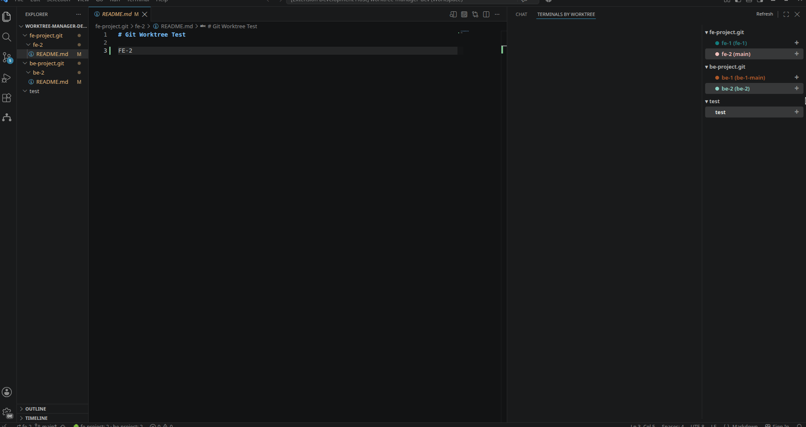

<div align="center">

# 🌳 Worktree Workspace Manager

**A simple VS Code control center for git worktrees.**

Focus one branch, keep terminals organized, and manage bare-repo worktree projects without leaving your workspace.



</div>

---

## Why use it?

Git worktrees are great for working on multiple branches at once, but VS Code can get noisy fast. Worktree Workspace Manager keeps that workflow clean:

- **See every worktree** in one tree view, grouped by repository.
- **Focus a branch in one click** by hiding other worktrees and closing unrelated editors.
- **Group terminals by worktree** so shells stay attached to the branch they belong to.
- **Open scoped terminals** directly from a worktree.
- **Create, remove, fetch, and prune** worktrees from VS Code.
- **Color-code worktrees** automatically, with quick manual overrides.
- **Detect bare repos from workspace folders** instead of hand-editing workspace settings.

Built for the common bare-repo layout:

```text
my-project/
  .bare/      # git metadata
  .git        # points git to .bare
  main/       # worktree
  feature-x/  # worktree
  bugfix-y/   # worktree
```

---

## Quick start

Requirements: VS Code 1.90+ and `git` on your `PATH`.

1. Open a `.code-workspace` workspace.
2. Click **🌳 Worktree Manager** in the status bar.
3. Choose **Clone Git Repository…** or **Add Existing Git Repository…**.
4. Run the generated terminal commands when prompted.
5. Use **Add Worktree…**, then select a worktree to focus it.

Prefer manual setup? Add your bare-repo root as a VS Code workspace folder.

Supported workspace folder paths:

- a project folder containing `.bare`
- a direct bare repo folder such as `my-project.git`

## How to configure an existing git repo as a bare repo


Replace `/path/to/my-project` with your repository path.

```sh
# 1. Copy and paste this code to terminal

cd '/path/to/my-project'
branch="$(git branch --show-current)"
[ -n "$branch" ] || branch="HEAD"
staging=".wtwm-main"
[ ! -e "$staging" ] || { echo "$staging already exists" >&2; exit 1; }
mkdir "$staging"
find . -mindepth 1 -maxdepth 1 ! -name '.git' ! -name "$staging" -exec mv {} "$staging"/ \;
mv .git .bare
echo 'gitdir: .bare' > .git
git --git-dir=.bare config core.bare true
git --git-dir=.bare config remote.origin.fetch '+refs/heads/*:refs/remotes/origin/*'
git --git-dir=.bare worktree add --no-checkout main "$branch"
find "$staging" -mindepth 1 -maxdepth 1 -exec mv {} main/ \;
rmdir "$staging"
git -C main reset --mixed HEAD

# 2. Create a VS Code workspace file

cat <<'EOF' > '/path/to/my-project.code-workspace'
{
  "folders": [
    {
      "name": "my-project",
      "path": "/path/to/my-project"
    }
  ]
}
EOF

# 3. Open VS Code through the workspace

code '/path/to/my-project.code-workspace'
```

---

## Main commands

| Command                          | Purpose                                             |
| -------------------------------- | --------------------------------------------------- |
| **Clone Git Repository…**        | Create the bare-repo worktree layout from a remote. |
| **Add Existing Git Repository…** | Register or convert an existing repository.         |
| **Add Worktree…**                | Create a branch worktree.                           |
| **Select Worktree**              | Focus one worktree and hide the rest.               |
| **Open Terminal Here**           | Start a terminal scoped to that worktree.           |
| **Change Worktree Color…**       | Customize a worktree color.                         |
| **Remove Worktree**              | Run `git worktree remove`.                          |
| **Fetch / Prune Stale**          | Keep repository metadata current.                   |

## Terminal keyboard shortcuts

| Action | Linux / Windows | macOS |
| --- | --- | --- |
| Focus active embedded terminal | `Ctrl+Alt+Shift+T` | `Cmd+Option+Shift+T` |
| Select terminal above | `Ctrl+Alt+Shift+Up` | `Cmd+Option+Shift+Up` |
| Select terminal below | `Ctrl+Alt+Shift+Down` | `Cmd+Option+Shift+Down` |

Terminal selection follows the visible order and wraps at either end. These are
VS Code default keybindings rather than hard-coded listeners. Change or remove
them with **Preferences: Open Keyboard Shortcuts** or in `keybindings.json`.

Embedded terminals are not restored after the extension or VS Code stops. On
shutdown, running foreground commands are interrupted and their shells receive
a hangup signal. Detached commands such as `nohup` jobs may continue running.

### Validating terminal scrollback

Run the fixed clear-screen redraw fixture inside an embedded terminal:

```bash
npm run stress:terminal-scrollback
```

After screen 12 appears, scroll upward. Screens 1 through 11 should remain in
the terminal history even though each update clears and redraws the viewport.

---

## Settings

| Setting                                | Description                                           |
| -------------------------------------- | ----------------------------------------------------- |
| `worktreeManager.terminalShell`        | Optional shell path for extension terminals.          |
| `worktreeManager.terminalsLayoutOrder` | Order of terminal and selector in the terminal panel. |
| `worktreeManager.webviewRenderTelemetry` | Optional sampled/all webview render duration logs.  |
| `worktreeManager.profileMarkers`       | Enable performance marks/measures for hot paths.      |
| `worktreeManager.colors`               | Auto-managed worktree colors, editable from the UI.   |

---

## Profiling performance

1. Enable markers in VS Code settings:

   ```json
   "worktreeManager.profileMarkers": true,
   "worktreeManager.webviewRenderTelemetry": "sampled"
   ```

   You can also launch VS Code with `WTWM_PROFILE=1` to enable extension-host markers.
2. Run **Developer: Show Logs...** and open **Extension Host** or the **Terminals by Worktree** output channel. Look for `profile measure` entries such as `wtwm:terminal.renderSessions` and `wtwm:model.listAllWorktrees`.
3. For UI/render details, run **Developer: Open Webview Developer Tools**, select the Terminals by Worktree webview, use the Performance tab, and record while refreshing/selecting worktrees. Marks are named `wtwm.webview:*`.
4. Keep profiling off for normal use; markers are gated to avoid adding overhead during regular terminal output.

---

## Notes

- A `.code-workspace` file is recommended so focus mode can update workspace excludes.
- Git remains the source of truth; the extension does not maintain a separate worktree database.
- This extension is designed for bare-repo + worktree workflows, not normal single-folder repos.

## License

MIT
